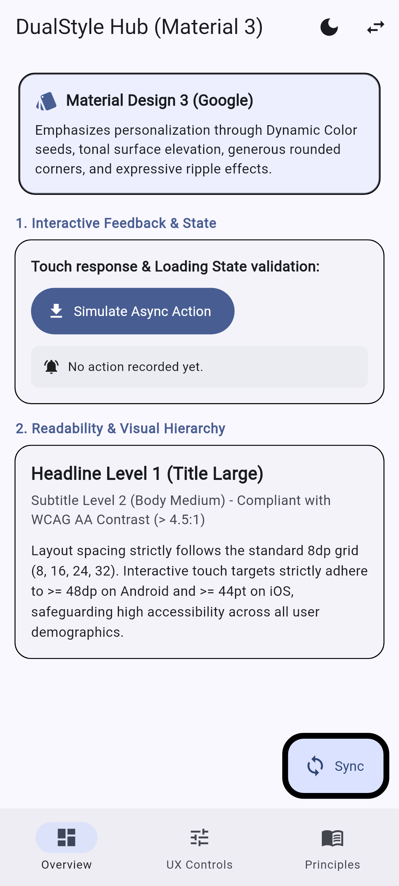
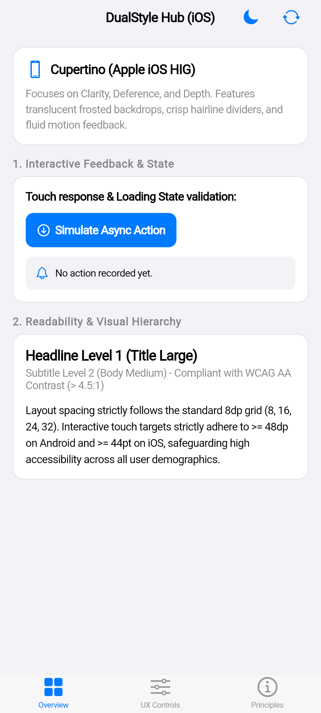
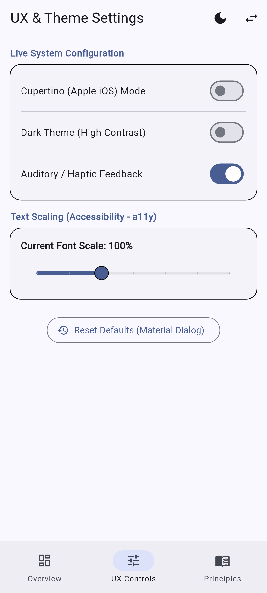
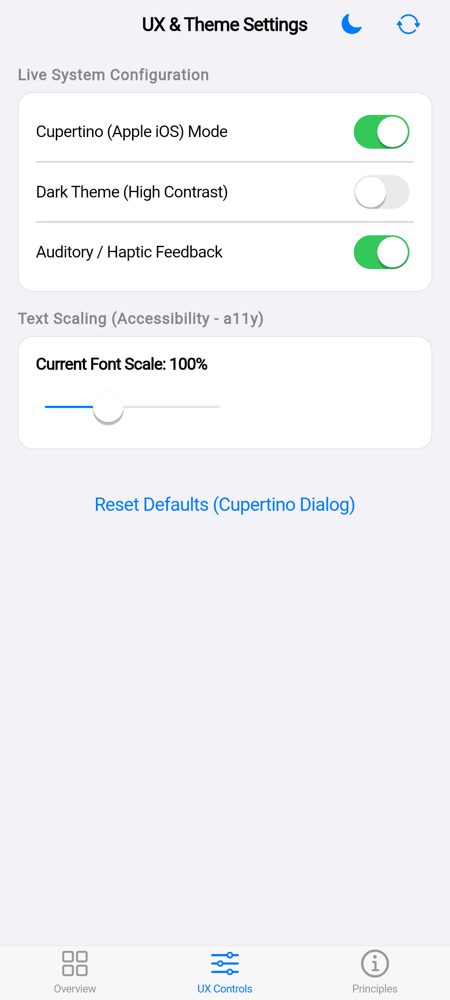
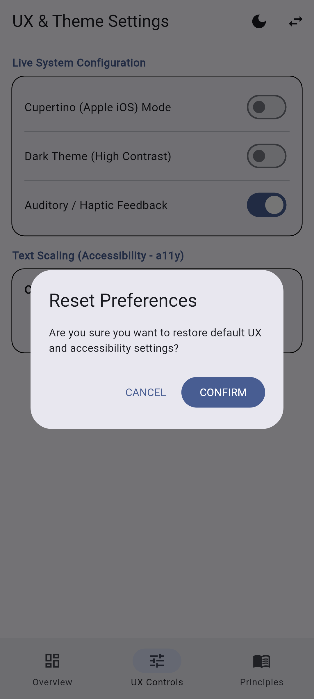
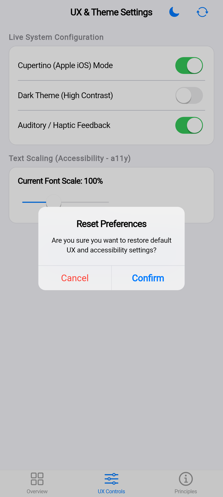
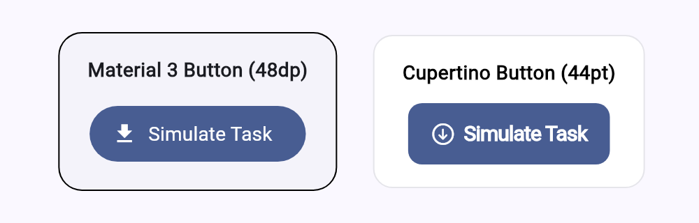

# Tuần 03 — Chủ Đề 04: Thiết Kế Giao Diện Đa Phong Cách và Nguyên Tắc UX

- **Môn học**: Lập trình Đa nền tảng
- **Giảng viên hướng dẫn**: TS. Nguyễn Duy Nhật Viễn
- **Sinh viên thực hiện**: Huỳnh Thiện Lộc (MSSV: 106230052) — Tỷ lệ đóng góp: 100%

---

## 1. Đề Bài Yêu Cầu Từ Giảng Viên (Spec)

> **Chủ đề 4. Thiết kế giao diện đa phong cách và nguyên tắc UX**
> 
> 1. **Cơ sở lý thuyết**
>    - Tổng quan Material Design và Cupertino.
>    - Scaffold, AppBar, theme, typography và hệ thống màu.
>    - Tính nhất quán, phản hồi tương tác, khả năng đọc và khả năng tiếp cận cơ bản.
> 
> 2. **Yêu cầu thực hành và demo**
>    - Xây dựng giao diện tuân theo một hệ thống thiết kế nhất quán.
>    - Giải thích các lựa chọn về thành phần, chủ đề và trải nghiệm người dùng.

> **Quy ước chuẩn hóa:**
> - Toàn bộ mã nguồn, chú thích (`comments`) và văn bản giao diện người dùng (`UI Labels, Microcopy`) được đồng bộ bằng **Tiếng Anh (English)** theo tiêu chuẩn phát triển ứng dụng di động quốc tế.
> - Tài liệu phân tích và slide báo cáo được trình bày khoa học kèm đối chiếu thực tế.

---

## 2. Cấu Trúc Thư Mục Tuần 03

```text
week_03/
├── app/                                 # Ứng dụng Flutter Demo Đa Phong Cách & Widget Tests
│   ├── lib/
│   │   ├── main.dart                    # Giao diện chính 3 Tab, Hot-toggle Material 3 & Cupertino
│   │   ├── theme/
│   │   │   └── app_theme.dart           # Cấu hình M3 Seed, CupertinoThemeData, Spacing Tokens
│   │   └── widgets/
│   │       └── adaptive_widgets.dart    # AdaptivePrimaryButton, AdaptiveLoading, AdaptiveDialog
│   └── test/
│       ├── widget_test.dart             # 4 kịch bản kiểm thử giao diện & chuẩn a11y (100% Passed)
│       ├── screenshot_goldens_test.dart # Tự động render chụp ảnh màn hình các trạng thái UI
│       └── goldens/                     # Ảnh chụp màn hình giao diện thực tế
│           ├── material_overview.png
│           ├── material_settings.png
│           ├── cupertino_overview.png
│           └── cupertino_settings.png
├── docs/                                # Tài liệu chi tiết & Đề cương slide
│   ├── 01_THEORY_AND_UX_ANALYSIS.md     # Cơ sở lý thuyết, đối chiếu M3 vs HIG và 4 trụ cột UX
│   └── 02_SLIDE_OUTLINE.md              # Đề cương cấu trúc slide 4 phần logic
└── slide/                               # Slide báo cáo Typst (typslides + fletcher vector diagram)
    ├── main.typ                         # Mã nguồn slide Typst nhúng ảnh đối chiếu
    ├── main.pdf                         # Bản PDF trình chiếu hoàn chỉnh (19 trang chuẩn 16:9)
    ├── material_overview.png            # Ảnh demo Material 3 tab Tổng quan
    ├── material_settings.png            # Ảnh demo Material 3 tab Tùy chỉnh
    ├── cupertino_overview.png           # Ảnh demo Cupertino tab Tổng quan
    └── cupertino_settings.png           # Ảnh demo Cupertino tab Tùy chỉnh
```

---

## 3. Ảnh Chụp Đối Chiếu Giao Diện Thực Tế

| Màn hình / Thành phần | Material Design 3 (Google) | Cupertino (Apple iOS HIG) |
| :---: | :---: | :---: |
| **Tab 1: Overview & Interactive Feedback** |  |  |
| **Tab 2: UX Controls & Text Scaling (a11y)** |  |  |
| **Modal: Adaptive Confirmation Dialog** |  |  |
| **Component: Touch Target Buttons** |  |  |

---

## 4. Kiến Trúc Kỹ Thuật & Quyết Định Thiết Kế (Design Decisions)

### 3.1. Kiến trúc Điều phối Giao diện Thích ứng (Adaptive Architecture)
```
[ AppStateNotifier ] (Style: Material / Cupertino | DarkMode: Sáng / Tối)
         |
         v (notifyListeners)
[ Root MultiStyleUXApp ] 
         ├──> (Material)  : MaterialApp + MaterialThemeConfig (M3 ColorScheme Seed)
         └──> (Cupertino) : CupertinoApp + CupertinoThemeConfig (Dynamic Colors)
                  |
                  v
          [ HomeScreen (3 Tabs) ]
                  ├── Tab 1: Tổng quan tương tác & Thử nghiệm phản hồi chạm
                  ├── Tab 2: Tùy chỉnh UX (Cỡ chữ a11y slider, Haptics, DarkMode)
                  └── Tab 3: Thư viện tóm tắt Lý thuyết & Nguyên tắc UX
```

### 3.2. Hiện thực 4 Trụ Cột Nguyên Tắc UX
1. **Tính Nhất Quán (Consistency):**
   - Định nghĩa `AppTokens` chuẩn hóa toàn bộ Spacing theo lưới 8dp (`space8`, `space16`, `space24`, `space32`).
   - Phân biệt nhất quán nội tại (Internal) và nhất quán nền tảng (Platform Native Guidelines).
2. **Phản Hồi Tương Tác (Interactive Feedback):**
   - Loại bỏ hoàn toàn tình trạng giao diện "chết": Mỗi lần bấm đều có phản hồi tức thời trong 100ms (`InkWell` ripple trên Android, giảm độ mờ 40% trên iOS).
   - Tác vụ bất đồng bộ (giả lập 1200ms) hiển thị `AdaptiveLoadingIndicator` tương ứng và thông báo phản hồi qua `SnackBar` (Material) hoặc Card trạng thái (Cupertino).
3. **Khả Năng Đọc (Readability):**
   - Phân cấp thị giác phân minh: Headline (Bold, 18-22pt) -> Subtitle (Mờ 70%, 14pt) -> Body Text (14pt, line-height 1.4 - 1.5).
   - Đảm bảo tỷ lệ tương phản chữ/nền luôn đạt chuẩn WCAG AA ($> 4.5:1$).
4. **Khả Năng Tiếp Cận Cơ Bản (Accessibility - a11y):**
   - Cung cấp thanh trượt tùy chỉnh kích cỡ font chữ từ $80\%$ đến $140\%$.
   - Kích thước vùng chạm cảm ứng luôn đạt hoặc vượt chuẩn: $\ge 48\times 48\text{ dp}$ đối với Material và $\ge 44\times 44\text{ pt}$ đối với Cupertino.
   - Bọc các thành phần tương tác trong widget `Semantics` cho TalkBack / VoiceOver.

---

## 4. Hướng Dẫn Biên Dịch & Chạy Thử

### 4.1. Xem & Biên dịch Slide Báo Cáo
```bash
# Xem slide PDF đã biên dịch:
xdg-open slide/main.pdf

# Hoặc biên dịch lại mã nguồn Typst:
typst compile slide/main.typ slide/main.pdf
```

### 4.2. Chạy Kiểm Thử Tự Động (Widget Tests)
```bash
cd app
flutter test test/widget_test.dart
```

### 4.3. Chạy Ứng Dụng Thực Tế
```bash
cd app
flutter pub get
flutter run
```
