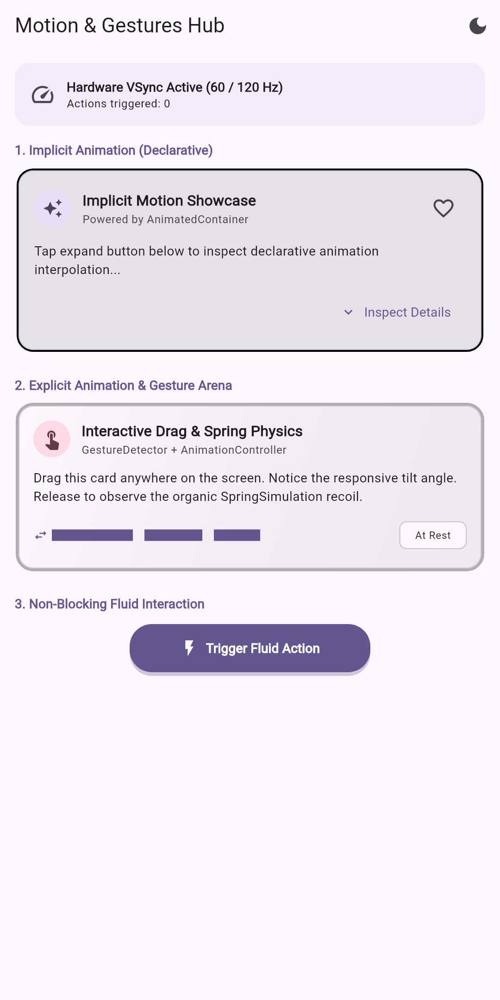
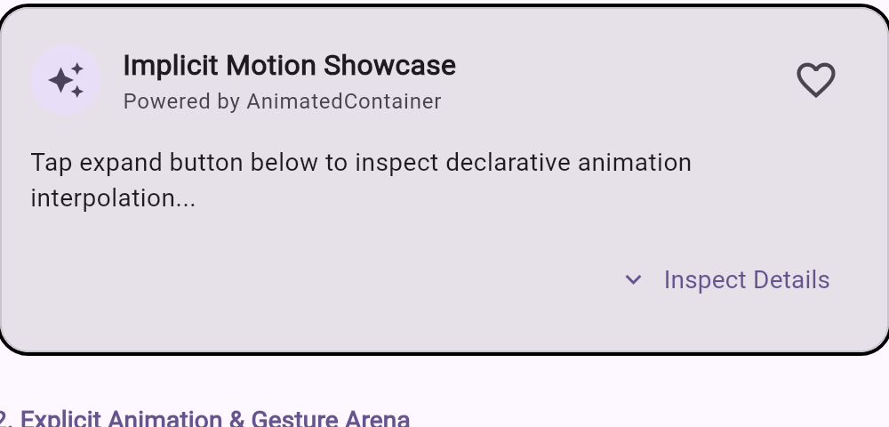
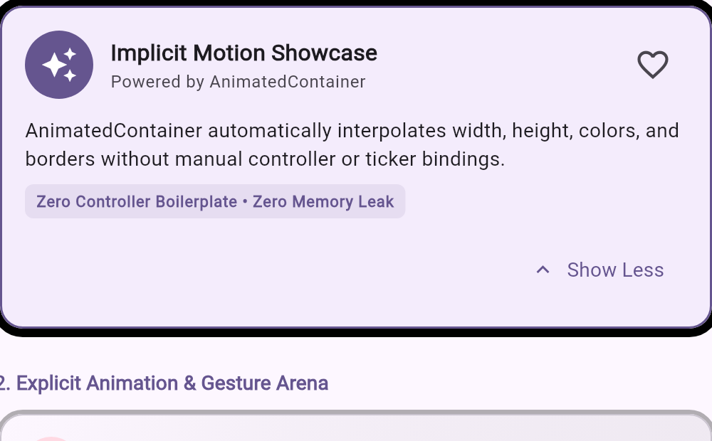
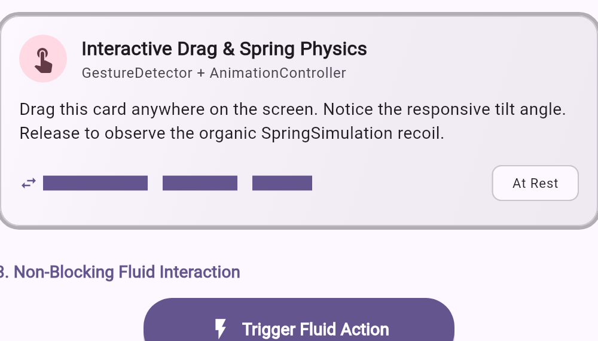
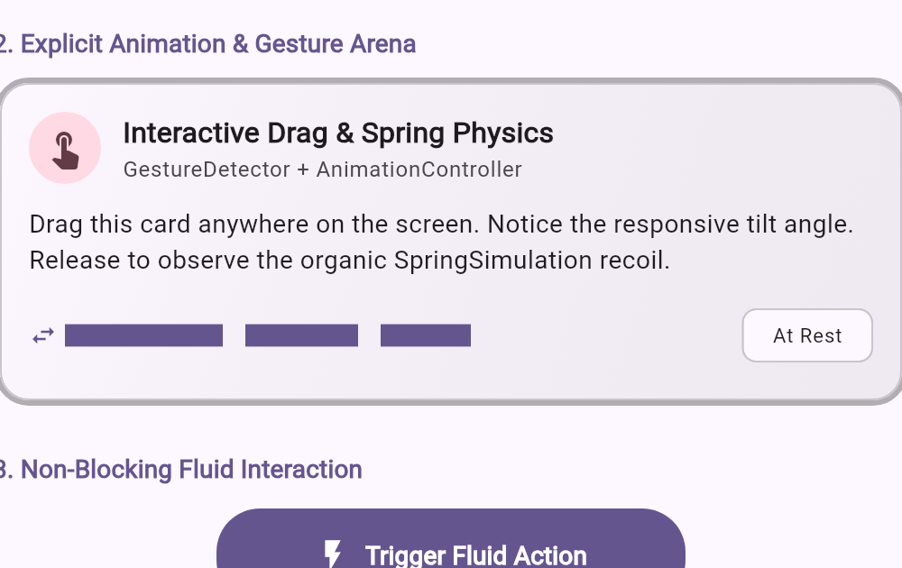

<!-- _class: lead-title -->
# Animation & Cử Chỉ Nâng Cao
### TRƯỜNG ĐẠI HỌC BÁCH KHOA — ĐẠI HỌC ĐÀ NẴNG

Chủ đề 08: Báo cáo Tuần 04 — Môn: Lập trình Đa nền tảng

  <b>SVTH:</b> Huỳnh Thiện Lộc — <b>MSSV:</b> 106230052  
  <b>GVHD:</b> TS. Nguyễn Duy Nhật Viễn

<!-- note:
Chào Thầy và các bạn. Hôm nay em xin báo cáo Chủ đề 08: Animation và Cử chỉ nâng cao trong Flutter.
-->

---

## Nội dung báo cáo

  

    <ol>
      <li><b>Animation & UX Roles</b></li>
      <li><b>Requirements (Spec)</b></li>
      <li><b>Flutter Animation Architecture</b></li>
      <li><b>Implicit vs Explicit Matrix</b></li>
      <li><b>Explicit Lifecycle & Memory Safety</b></li>
      <li><b>Gesture Arena & Disambiguation</b></li>
      <li><b>UX Motion Principles & Latency</b></li>
    </ol>
  

  

    <ol start="8">
      <li><b>Application Architecture</b></li>
      <li><b>Implicit Motion: State Interpolation</b></li>
      <li><b>Explicit & Gestures: Spring Physics</b></li>
      <li><b>Automated Verification & Tests</b></li>
      <li><b>Engineering Decision Tree</b></li>
      <li><b>References & Verified Sources</b></li>
    </ol>
  

<!-- note:
Bài báo cáo gồm 3 phần lớn: Bản chất UX & Kiến trúc Flutter, Đấu trường cử chỉ, và Thực hành ứng dụng demo kèm kiểm thử.
-->

---

## 1. Animation & UX Roles

  

    
Trụ Cột 1

    <h3 style="color: #2563eb; margin: 10px 0 6px 0;">State Continuity</h3>
    

      <b>Tính liên tục không gian:</b> Loại bỏ hiện tượng giật cục khi chuyển trang hoặc thay đổi kích thước layout.
    

  

  

    
Trụ Cột 2

    <h3 style="color: #ea580c; margin: 10px 0 6px 0;">Guided Focus</h3>
    

      <b>Dẫn dắt sự chú ý:</b> Hướng mắt người dùng nhận biết tức thì điểm xuất hiện của dữ liệu hoặc kết quả vừa xử lý.
    

  

  

    
Trụ Cột 3

    <h3 style="color: #16a34a; margin: 10px 0 6px 0;">Touch Feedback</h3>
    

      <b>Phản hồi xúc giác &lt; 100ms:</b> Xác nhận thao tác chạm ngay lập tức, triệt tiêu việc bấm lặp do tưởng ứng dụng bị đơ.
    

  

<!-- note:
Animation không phải để trang trí. Nó giải quyết 3 bài toán UX lớn: Tính liên tục không gian, Dẫn hướng mắt, và Phản hồi tức thì dưới 100ms.
-->

---

## 2. Requirements (Spec)

  

    <h3 style="color: #1d4ed8; margin-top: 0;">1. Theoretical Foundation</h3>
    <ul style="font-size: 0.95rem; line-height: 1.6;">
      <li><b>Implicit Animation:</b> <code>AnimatedContainer</code> & tự động nội suy.</li>
      <li><b>Explicit Animation:</b> <code>AnimationController</code> & quản lý tài nguyên.</li>
      <li><b>Gesture Arena:</b> Xung đột chạm & thời điểm kích hoạt.</li>
      <li><b>Non-blocking UX:</b> Chuyển động không gây cản trở thao tác.</li>
    </ul>
  

  

    <h3 style="color: #16a34a; margin-top: 0;">2. Practice & Demo</h3>
    <ul style="font-size: 0.95rem; line-height: 1.6;">
      <li><b>Implicit Card:</b> Biến đổi kích thước, màu sắc & viền mượt mà.</li>
      <li><b>Draggable Spring Card:</b> Pan 2D kèm quán tính lò xo.</li>
      <li><b>Morphing Button:</b> Xử lý async không khóa UI pipeline.</li>
      <li><b>Automated Tests:</b> 5/5 test pass, 0 memory leak.</li>
    </ul>
  

<!-- note:
Đề bài yêu cầu nắm vững cả 2 trường phái Implicit & Explicit, phân giải xung đột Gesture, và chứng minh tính không cản trở thao tác.
-->

---

## 3. Flutter Animation Architecture

  

    TẦNG WIDGETS (KHỞI TẠO)
    <code>AnimatedContainer</code> (Implicit) | <code>SlideTransition</code> (Explicit)
  

  

    TẦNG ĐIỀU KHIỂN & NỘI SUY
    <code>AnimationController</code> (0.0 → 1.0) | <code>Tween&lt;T&gt;</code> | <code>CurvedAnimation</code>
  

  

    TẦNG LÀM TƯƠI ĐỒNG BỘ
    <code>Ticker</code> & <code>TickerProvider</code> (Khóa xung VSync 60Hz / 120Hz)
  

  

    TẦNG PHẦN CỨNG (GPU RENDER)
    Chỉ cập nhật Transform Layer | <b>Không rebuild Widget con</b>
  

<!-- note:
Kiến trúc phân tầng Flutter: Widget chỉ là bản khai báo. Ticker bắt nhịp VSync từ hệ điều hành, và GPU chỉ việc cập nhật Layer biến hình mà không phải rebuild lại cây widget.
-->

---

## 4. Implicit vs Explicit Matrix

<table>
  <thead>
    <tr>
      <th>Đặc Tính Kỹ Thuật</th>
      <th>Implicit Animation (Khai báo)</th>
      <th>Explicit Animation (Mệnh lệnh)</th>
    </tr>
  </thead>
  <tbody>
    <tr>
      <td><b>Cơ chế điều khiển</b></td>
      <td>Truyền Target Value, tự nội suy</td>
      <td>Dùng <code>AnimationController</code> thủ công</td>
    </tr>
    <tr>
      <td><b>Mức độ linh hoạt</b></td>
      <td>Chạy 1 chiều từ A → B</td>
      <td>Toàn quyền: <code>forward</code>, <code>reverse</code>, <code>repeat</code>, <code>spring</code></td>
    </tr>
    <tr>
      <td><b>Nguy cơ Memory Leak</b></td>
      <td>ZERO LEAK (An toàn 100%)</td>
      <td>CAO (Bắt buộc phải dispose)</td>
    </tr>
    <tr>
      <td><b>Boilerplate Code</b></td>
      <td>Cực ít, không cần Ticker</td>
      <td>Cần <code>SingleTickerProviderStateMixin</code></td>
    </tr>
    <tr>
      <td><b>Ứng dụng thực tế</b></td>
      <td>Đổi màu nút, mở rộng thẻ, fade in/out</td>
      <td>Kéo thả cử chỉ, nảy lò xo, chuyển động lặp</td>
    </tr>
  </tbody>
</table>

<!-- note:
Implicit là lựa chọn mặc định an toàn tuyệt đối. Chỉ chuyển sang Explicit khi cần lặp lại, đảo chiều, hoặc gắn kết theo cử chỉ người dùng.
-->

---

## 5. Explicit Lifecycle & Memory Safety

  

    
Pha 1: Khởi Tạo (Mount)

    <h3 style="color: #166534; margin: 10px 0;">initState()</h3>
    <ul style="font-size: 0.95rem; line-height: 1.5;">
      <li><code>SingleTickerProviderStateMixin</code> khởi tạo <code>Ticker</code>.</li>
      <li>Ticker lắng nghe xung VSync màn hình.</li>
      <li><b>Ticker giữ Strong Reference tới State.</b></li>
    </ul>
  

  

    
Pha 2: Giải Phóng (Unmount)

    <h3 style="color: #991b1b; margin: 10px 0;">dispose()</h3>
    <ul style="font-size: 0.95rem; line-height: 1.5;">
      <li><b>Bước 1:</b> <code>controller.dispose()</code> (Ngắt Ticker).</li>
      <li><b>Bước 2:</b> <code>super.dispose()</code> (Dọn State).</li>
      <li><b>Làm ngược:</b> Crash & Memory Leak vĩnh viễn!</li>
    </ul>
  

  <b>Quy tắc vàng:</b> Luôn giải phóng controller TRƯỚC <code>super.dispose()</code>. Nếu Ticker còn sống, Garbage Collector không thể thu hồi State object.

<!-- note:
Điểm Giảng viên hay hỏi nhất: Vì sao controller.dispose() phải gọi trước super.dispose()? Vì super.dispose sẽ đóng TickerProvider; nếu Ticker còn sống, Flutter sẽ ném framework assertion error ngay lập tức.
-->

---

## 6. Gesture Arena & Disambiguation

  

    <b>BƯỚC 1: TIẾP NHẬN CHẠM (PointerDown)</b>
    Hit-testing
    

      Mọi Recognizer thỏa mãn tọa độ chạm (Tap, Drag dọc, Drag ngang) đều bước vào Đấu trường.
    

  

  

    <b>BƯỚC 2: MÀNG LỌC TOUCH SLOP (&gt; 18dp)</b>
    Trajectory Filter
    

      Ngón tay di chuyển: Recognizer ngược hướng tự rút lui (<b>Self-elimination</b>).
    

  

  

    <b>BƯỚC 3: CHIẾN THẮNG (Declare Win)</b>
    Resolution
    

      Cử chỉ ưu thế tuyên bố thắng cuộc; toàn bộ đối thủ còn lại lập tức bị loại.
    

  

  <b>Phân cấp Cha - Con:</b> Widget con được đưa vào Arena trước → Ưu tiên thắng theo <i>First-Come, First-Served</i>.

<!-- note:
Đấu trường cử chỉ phân định qua 3 bước: PointerDown, Touch Slop 18dp lọc hướng, và Declare Win. Widget con luôn được nạp trước nên có ưu thế hơn widget cha.
-->

---

## 7. UX Motion Principles & Latency

  

    <h2 style="color: #166534; margin: 0; font-size: 1.9rem; border: none;">&lt; 100 ms</h2>
    
Phản Hồi Xúc Giác

    
Tức thì, loại bỏ cảm giác trễ ngón tay

  

  

    <h2 style="color: #1e40af; margin: 0; font-size: 1.9rem; border: none;">150 - 350 ms</h2>
    
Chuyển Cảnh Tối Ưu

    
Mượt mà, áp dụng đường cong gia tốc

  

  

    <h2 style="color: #991b1b; margin: 0; font-size: 1.9rem; border: none;">&gt; 500 ms</h2>
    
Ngưỡng Gây Ức Chế

    
Gây cảm giác lề mề, cản trở thao tác

  

  

    • <b>Non-Blocking:</b> Không khóa cảm ứng khi animation đang chạy. 
    • <b>Interruptible:</b> Cho phép đổi chiều hoặc buông tay giữa chừng.
  

  

    • <b>Guided Focus:</b> Dẫn hướng mắt theo luồng thông tin. 
    • <b>Reduced Motion:</b> Hỗ trợ tắt animation cho người say xe thị giác.
  

<!-- note:
Về mặt tâm lý học thời gian: Phản hồi chạm phải dưới 100ms, chuyển cảnh 150-350ms. Trên 500ms người dùng sẽ bắt đầu thấy khó chịu và bực bội.
-->

---

## 8. Application Architecture

  

    <h3 style="color: #1d4ed8; margin-top: 0;">Kiến trúc Demo App (week_04/app)</h3>
    <ul style="font-size: 0.95rem; line-height: 1.6;">
      <li><b>MotionTokens (Lưới 8dp):</b>
        <code>space8</code>, <code>space16</code>, <code>space24</code> chuẩn thiết kế.
      </li>
      <li><b>3 Phân hệ chuyển động độc lập:</b>
        <ol>
          <li><code>ImplicitMotionCard</code>: Tự nội suy Declarative.</li>
          <li><code>DragSpringCard</code>: Gesture Arena + Lò xo.</li>
          <li><code>MorphingActionButton</code>: Async không chặn UI.</li>
        </ol>
      </li>
      <li><b>Đồng bộ VSync:</b> Tự động phát nhịp 60Hz / 120Hz.</li>
    </ul>
  

  

    
  

<!-- note:
Ứng dụng demo được thiết kế theo chuẩn Clean Architecture, tách biệt rõ 3 phân hệ chuyển động tương ứng với 3 yêu cầu của đề bài.
-->

---

## 9. Implicit Motion: State Interpolation

  

    1. Trạng Thái Ban Đầu (At Rest)
    

      
    

  

  

    2. Trạng Thái Mở Rộng (Interpolated)
    

      
    

  

  <b>AnimatedContainer:</b> Tự động tính toán biến thiên kích thước, màu nền và độ bo góc khi Target Value đổi mà không cần bất kỳ <code>AnimationController</code> nào.

<!-- note:
Khi bấm nút, AnimatedContainer tự so sánh kích thước cũ và mới rồi nội suy mượt mà qua từng frame. Hoàn toàn không phát sinh rò rỉ bộ nhớ.
-->

---

## 10. Explicit & Gestures: Spring Physics

  

    1. Trạng Thái Ở Gốc (Offset 0, 0)
    

      
    

  

  

    2. Đang Kéo & Xoay Góc Quán Tính
    

      
    

  

  <b>GestureDetector + SpringSimulation:</b> Bắt tọa độ 2D pan để xoay góc thẻ; khi buông tay, mô phỏng vật lý lò xo kéo thẻ nảy về gốc <code>(0.0, 0.0)</code> theo đúng vận tốc vung tay.

<!-- note:
Sử dụng GestureDetector kết hợp SpringSimulation. Góc nghiêng tự tính theo độ dời pan. Buông tay ra là thẻ tự nảy đàn hồi về gốc theo đúng vận tốc tay người dùng.
-->

---

## 11. Automated Verification & Tests

  <h3 style="color: #166534; margin-top: 0;">5/5 Kịch Bản Kiểm Thử Tự Động Passed 100% (~2.5s)</h3>
  <ol style="font-size: 0.95rem; line-height: 1.7; margin-bottom: 0;">
    <li><b>Launch M3:</b> Khởi chạy thành công giao diện và render đầy đủ 3 phân hệ.</li>
    <li><b>Implicit Interpolation:</b> Kích hoạt mở rộng thẻ, kiểm tra biến thiên frame.</li>
    <li><b>Gesture Drag & Recoil:</b> Vuốt dời 80px, kiểm tra trạng thái Dragging và nảy về gốc (0,0).</li>
    <li><b>Non-Blocking Async:</b> Nút Morphing Button chạy tác vụ ngầm mà không khóa UI.</li>
    <li><b>Memory Leak Teardown:</b> Unmount widget, xác nhận thu hồi 100% Ticker.</li>
  </ol>

  ✓ flutter test: All tests passed! | ✓ dart analyze: No issues found!

<!-- note:
Toàn bộ mã nguồn đã được kiểm thử tự động 5/5 kịch bản, xác thực không còn Ticker nào bị bỏ quên khi màn hình bị unmount.
-->

---

## 12. Engineering Decision Tree

  

    
LỰA CHỌN MẶC ĐỊNH

    <h3 style="color: #166534; margin: 15px 0 10px 0;">Implicit Animation</h3>
    

      • Chỉ cần đổi giao diện khi state thay đổi. 
      • Chuyển động 1 chiều từ A → B. 
      • <b>Zero Memory Leak, viết code nhanh nhất.</b>
    

  

  

    
KHI CÓ NHU CẦU NÂNG CAO

    <h3 style="color: #991b1b; margin: 15px 0 10px 0;">Explicit Animation</h3>
    

      • Cần lặp lại vô hạn hoặc đảo chiều giữa chừng. 
      • Gắn kết trực tiếp với tọa độ kéo thả cử chỉ. 
      • <b>Bắt buộc phải quản lý dispose() nghiêm ngặt.</b>
    

  

<!-- note:
Cây quyết định: Hãy luôn chọn Implicit làm mặc định để an toàn và tiết kiệm chi phí bảo trì. Chỉ dùng Explicit khi thực sự cần kiểm soát hướng chuyển động và cử chỉ phức tạp.
-->

---

## 13. References & Verified Sources

  

    <h4 style="color: #1d4ed8; margin-bottom: 8px;">Official Flutter Documentation</h4>
    • Flutter Animations Overview: 
      <a href="https://docs.flutter.dev/ui/animations/overview">docs.flutter.dev/ui/animations/overview</a> 
    • Implicit Animations Guide: 
      <a href="https://docs.flutter.dev/ui/animations/implicit-animations">docs.flutter.dev/ui/animations/implicit-animations</a> 
    • Gestures & Disambiguation Arena: 
      <a href="https://docs.flutter.dev/ui/interactivity/gestures">docs.flutter.dev/ui/interactivity/gestures</a>
  

  

    <h4 style="color: #1d4ed8; margin-bottom: 8px;">API Reference & Design System</h4>
    • <code>AnimationController</code> Class: 
      <a href="https://api.flutter.dev/flutter/animation/AnimationController-class.html">api.flutter.dev/AnimationController</a> 
    • <code>GestureArenaManager</code> Class: 
      <a href="https://api.flutter.dev/flutter/gestures/GestureArenaManager-class.html">api.flutter.dev/GestureArenaManager</a> 
    • Material Design 3 Motion Principles: 
      <a href="https://m3.material.io/styles/motion/overview/how-it-works">m3.material.io/styles/motion</a>
  

  <i>Tất cả các liên kết tham khảo đã được kiểm tra kết nối trực tiếp (HTTP 200 OK).</i>

<!-- note:
Toàn bộ tài liệu tham khảo chính thức đều được kiểm tra mở và hoạt động bình thường. Em xin cảm ơn Thầy và các bạn đã theo dõi bài báo cáo.
-->
