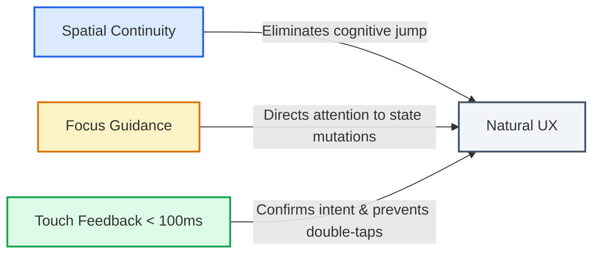
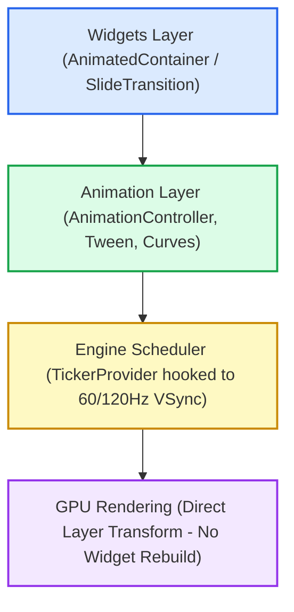
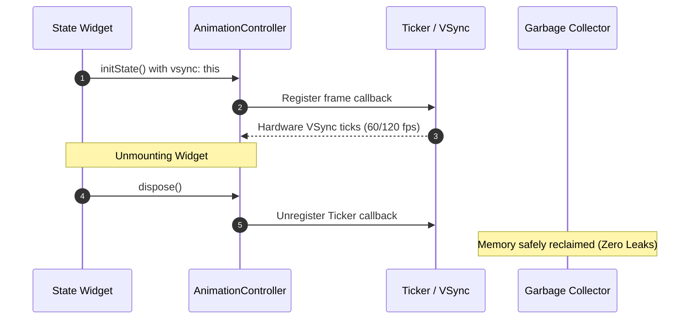
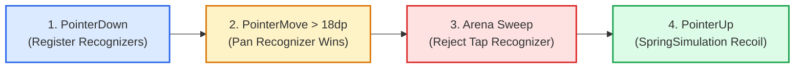

# Advanced Animations & Gestures in Flutter
Topic 08 — Cross-Platform Development

**Student:** Huỳnh Thiện Lộc (106230052)  
**Instructor:** TS. Nguyễn Duy Nhật Viễn

<div class="pt-4 flex gap-2">
  <span class="px-2 py-1 bg-blue-100 text-blue-800 rounded text-xs font-semibold">Flutter Motion</span>
  <span class="px-2 py-1 bg-green-100 text-green-800 rounded text-xs font-semibold">Gesture Arena</span>
  <span class="px-2 py-1 bg-purple-100 text-purple-800 rounded text-xs font-semibold">60/120 FPS VSync</span>
</div>

<!--
Báo cáo Chủ đề 08: Animation và Cử chỉ nâng cao trong Flutter.
-->

---
layout: two-cols
---

# Agenda

### Part 1: Core Mechanics
1. Animation & UX Roles
2. Technical Requirements
3. Flutter Motion Architecture
4. Implicit vs Explicit Matrix
5. Explicit Lifecycle & Memory Safety
6. Gesture Arena & Disambiguation
7. UX Latency Thresholds

::right::

<div class="pt-10">

### Part 2: Implementation & Evidence
8. Architecture & Motion Tokens
9. Implicit Motion: State Interpolation
10. Explicit Gestures: Spring Physics
11. Automated Test Suite
12. Decision Matrix
13. References

</div>

<!--
Nội dung báo cáo gồm 2 phần: Cơ chế cốt lõi và Ứng dụng demo thực tế kiểm thử 5/5 kịch bản.
-->

---

# 1. Animation & UX Roles



<!--
Animation giải quyết 3 bài toán UX lớn: Tính liên tục không gian, Dẫn hướng mắt, và Phản hồi tức thì dưới 100ms.
-->

---
layout: two-cols
---

# 2. Technical Requirements

### Theoretical Foundations
- **Implicit Animations:** Declarative target interpolation.
- **Explicit Animations:** Imperative `AnimationController`.
- **Gesture Arena:** Touch conflict disambiguation.
- **Non-blocking UX:** Unconstrained touch pipeline.

::right::

<div class="pt-10">

### Practical Deliverables
- **Implicit Card:** Shape, color, and size transitions.
- **Draggable Spring Card:** 2D pan + spring physics.
- **Morphing Button:** Non-blocking async feedback.
- **Automated Verification:** 5/5 test pass, 0 leaks.

</div>

<!--
Đề bài yêu cầu nắm vững cả 2 trường phái Implicit & Explicit, phân giải xung đột Gesture, và chứng minh tính không cản trở thao tác.
-->

---

# 3. Flutter Motion Architecture



<!--
Kiến trúc phân tầng Flutter: Widget chỉ là bản khai báo. Ticker bắt nhịp VSync từ hệ điều hành, GPU chỉ cập nhật Layer biến hình mà không rebuild widget con.
-->

---

# 4. Implicit vs Explicit Matrix

| Dimension | Implicit Animations | Explicit Animations |
| :--- | :--- | :--- |
| **Programming Model** | Declarative | Imperative |
| **Controller Management** | Managed internally by Framework | Manual `AnimationController` |
| **Memory Leak Risk** | **0% (Zero Leak)** | **High** (If unreleased in `dispose()`) |
| **Repeat / Reverse** | Not supported | Full control (`repeat()`, `reverse()`) |
| **Gesture Binding** | Incompatible | Direct pan coordinate sync |

<!--
Implicit cực kỳ an toàn vì không thể rò rỉ bộ nhớ, nhưng khi cần lặp vô hạn hoặc gắn với cử chỉ tay thì bắt buộc phải dùng Explicit.
-->

---

# 5. Explicit Lifecycle & Memory Safety



> **Memory Leak Hazard:** Omitting `dispose()` keeps `TickerProvider` retained in the Engine Scheduler via a **Strong Reference**, preventing GC unmount.

<!--
Vòng đời bắt đầu từ initState và kết thúc bắt buộc tại dispose. Quên dispose sẽ tạo Strong Reference khiến Garbage Collector không thể giải phóng màn hình.
-->

---

# 6. Gesture Arena & Disambiguation



- **2D Pan Tracking:** Real-time translation with dynamic tilt angle calculations.
- **SpringSimulation:** Natural damped harmonic recoil driven by release velocity.

<!--
Gesture Arena giải quyết xung đột: khi di chuyển vượt ngưỡng slop (18dp), PanRecognizer sẽ loại bỏ TapRecognizer để nhận toàn quyền cử chỉ.
-->

---

# 7. UX Latency Thresholds

| Latency | Classification | Practical Application |
| :--- | :--- | :--- |
| **< 100 ms** | Instant | Touch ripple, physical pressed states |
| **150 – 350 ms** | Natural (Gold Standard) | Navigation, element expansion, modal transitions |
| **> 500 ms** | Sluggish | Perceived as system lag; causes user friction |

- **Non-Blocking UX:** Keep animations interruptible; never freeze user gestures.

<!--
Về mặt tâm lý học thời gian: Phản hồi chạm phải dưới 100ms, chuyển cảnh 150-350ms. Trên 500ms người dùng sẽ bắt đầu thấy khó chịu và bực bội.
-->

---
layout: two-cols
---

# 8. Architecture & Motion Tokens

Demo App Structure (`week_04/app`):

- **MotionTokens (8dp Grid):**  
  `space8`, `space16`, `space24`.
- **Three Independent Subsystems:**
  1. `ImplicitMotionCard`: Declarative interpolation.
  2. `DragSpringCard`: Gesture Arena + Spring physics.
  3. `MorphingActionButton`: Non-blocking async feedback.
- **VSync Synchronization:**  
  Locked to 60Hz / 120Hz display refresh.

::right::

<div class="flex justify-center pt-2">
  
</div>

<!--
Ứng dụng demo được thiết kế theo chuẩn Clean Architecture, tách biệt rõ 3 phân hệ chuyển động tương ứng với 3 yêu cầu của đề bài.
-->

---
layout: two-cols
---

# 9. Implicit Motion: State Interpolation

### Motion Animation


::right::

### Target State


---

# 9. Implicit Motion: Mechanics

- **AnimatedContainer:** Interpolates property deltas across duration and curve.
- **Automatic State Sync:** Recomputes layout without external controllers.
- **Zero Resource Leaks:** Framework guarantees lifecycle teardown.

<!--
Khi bấm nút, AnimatedContainer tự so sánh kích thước cũ và mới rồi nội suy mượt mà qua từng frame. Hoàn toàn không phát sinh rò rỉ bộ nhớ.
-->

---
layout: two-cols
---

# 10. Explicit Gestures: Spring Physics

### Motion Animation


::right::

### Dynamic Tilt State


---

# 10. Explicit Gestures: Mechanics

- **GestureDetector (`onPanUpdate`):** Synchronizes card translation and rotational tilt with pointer coordinates.
- **SpringSimulation (`onPanEnd`):** Runs physical recoil back to `(0, 0)` preserving release inertia.
- **Resource Teardown:** Explicit disposal in `State.dispose()`.

<!--
Sử dụng GestureDetector kết hợp SpringSimulation. Góc nghiêng tự tính theo độ dời pan. Buông tay ra là thẻ tự nảy đàn hồi về gốc theo đúng vận tốc tay người dùng.
-->

---

# 11. Automated Test Suite

5/5 Test Specifications Passed (100% ~ 2.5s):

1. **Launch & Layout:** Validates Material 3 rendering of all three modules.
2. **Implicit Motion:** Tests smooth interpolation across intermediate frames.
3. **Gesture Drag & Recoil:** Tests 80px drag displacement and spring return.
4. **Non-Blocking Async:** Verifies UI pipeline responsiveness during simulated network work.
5. **Memory Leak Teardown:** Confirms zero lingering tickers after widget destruction.

```text
flutter test: All tests passed! (5/5)
dart analyze: No issues found!
```

<!--
Toàn bộ mã nguồn đã được kiểm thử tự động 5/5 kịch bản, xác thực không còn Ticker nào bị bỏ quên khi màn hình bị unmount.
-->

---
layout: two-cols
---

# 12. Decision Matrix

### Implicit Animations (Default)
- State-driven styling changes.
- Unidirectional transitions (A → B).
- **Benefits:** Zero memory leaks, minimal boilerplate, low maintenance.

::right::

<div class="pt-10">

### Explicit Animations (Advanced)
- Repeating, looping, or reversible sequences.
- Direct gesture synchronization (Pan / Drag).
- **Requirement:** Rigorous `dispose()` lifecycle management.

</div>

<!--
Cây quyết định: Luôn chọn Implicit làm mặc định. Chỉ dùng Explicit khi thực sự cần kiểm soát hướng chuyển động và cử chỉ phức tạp.
-->

---

# 13. References

- **Flutter Animations Overview:** [docs.flutter.dev/ui/animations/overview](https://docs.flutter.dev/ui/animations/overview)
- **Implicit Animations Guide:** [docs.flutter.dev/ui/animations/implicit-animations](https://docs.flutter.dev/ui/animations/implicit-animations)
- **Gestures & Disambiguation Arena:** [docs.flutter.dev/ui/interactivity/gestures](https://docs.flutter.dev/ui/interactivity/gestures)
- **AnimationController Class:** [api.flutter.dev/flutter/animation/AnimationController-class.html](https://api.flutter.dev/flutter/animation/AnimationController-class.html)
- **GestureArenaManager Class:** [api.flutter.dev/flutter/gestures/GestureArenaManager-class.html](https://api.flutter.dev/flutter/gestures/GestureArenaManager-class.html)
- **Material Design 3 Motion:** [m3.material.io/styles/motion/overview/how-it-works](https://m3.material.io/styles/motion/overview/how-it-works)

<!--
Em xin kết thúc bài báo cáo. Cảm ơn Thầy và các bạn đã theo dõi.
-->
